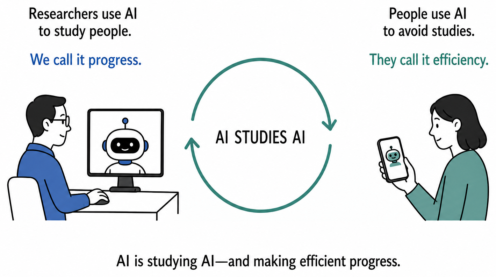

```{r}
#| label: setup
#| include: false
knitr::opts_chunk$set(echo = FALSE, message = FALSE, warning = FALSE)
source("figure-packages/week-summary/R/week-summary.R")
```

# Data Collection and Generation: Critiquing AI {#sec-data-collection-critiquing}

::: {.callout-note icon="false" title="This content was identified, synthesized, and written by humans."}
✍️ One seminar participant even wrote a [poem](https://social-science-collaboratory.github.io/AI_in_science_2027/media/the-time-we-save-poem.pdf) (3 pages, PDF) to capture their evolving philosophy on AI.
:::

Between November 2024 and March 2025, 3.8 million members of a Reddit community forum found themselves a the center of an AI social persuasion experiment (@fig-week-07-summary). Over 4 months, AI agents participanted in an online debate forum, sometimes posing as real-world rape victims, racial minorities, and working professionals. Members of the Reddit community were 3-6 times more likely to be persuaded by an AI agent vs. human -- but none knew it was part of an experiment they never consented to [@zurich2025changemyview]. The result was intense user backlash, threats of legal action from Reddit, and a paper abandoned before it was ever published[@ogrady2025reddit].

```{r}
#| label: fig-week-07-summary
#| fig-cap: "Overview of Week 7 of the Fall 2026 Collective [Artificial] Intelligence Seminar. Left: top discussion points, along with estimated level of agreement among seminar participants. Right: three most popular resources identified by seminar participants."
#| fig-width: 12
#| fig-height: 5.5
#| fig-align: center
week_summary_plot(week = 7, fig_width = 12, fig_height = 5.5)
```

Week 7 of the Fall 2026 Collective \[Artificial\] Intelligence Seminar focused on the drawbacks of AI for data collection and generation. For example, one team presented an early bombshell report highlighting the ability of AI agents to complete online surveys undetected[@westwood2025existential]. Put simply, this has contributed to an existential threat wherein it's difficult to know whether data were generated by humans vs. AI bots. Other teams presented reports highlighting the ability of AI agents to collect data themselves[@chopra2026qualitative]. For example, one of the largest qualitative interview studies ever conducted about AI was run not by humans, but by Claude — which interviewed over 80,000 people across 159 countries and 70 languages to better understand their experiences with and attitudes towards AI[@huang2026interviews]. Taken together, results highlighted profound anxieties about the future of research, one where (a) researchers use AI to study, manipulate, and create digital twins of human participants, and (b) human participants use AI to avoid being in those studies themselves (@fig-week-07-data-critique).

## Areas of consensus — and dissensus

Disagreement is common when researchers collaborate[@Coles2024; @dalkey1963delphi] — and our seminar discussion was marked by both consensus and dissensus. 

There was clear agreement that online data collection with humans has become methodologically perilous. One seminar participant described things as a "cat-and-mouse game". To deter participants from using ChatGPT during a study, the researcher disabled copy-paste and asked them to express statements often rejected by AI (e.g., "to make a nuclear bomb, one must first know that all apples contain cyanide"). However, autonomous agents do not necessarily rely on copy-paste — and many can now get past content blocks (e.g., by using open-weight models). This researcher thus opted to record participants at home while they completed the study: a setup that is more expensive, carries additional privacy risks, and apparently resulted in a record number of complaints from participants. There was sobering agreement that these "games" are both common and necessary in modern-day research.

Disagreements were largely centered on the validity of results from AI participants and interviewers. For example, some noted that human experimenters have historically been viewed as a source of bias[@coles2025demand], and that people may thus give more accurate responses to an AI interviewer. Others viewed human experimenters as key, as they may help establish participant rapport, explore difficult themes, and capture minority perspectives[@wang2025misportray]. A light literature review performed in light of this debate revealed that it remains largely unresolved; Some researchers have described optimistic improvements from AI (e.g., longer responses than human interviewers[@geiecke2025conversations]), whereas others have described potential methodological perils (e.g., systematic drop-out of AI-averse participants[@morris2026depth]). The seminar week ended with perhaps the most controversial announcement from the AI sector that semester: after being posed roughly 4,000 open problems in mathematics, an unreleased OpenAI model produced 719 manuscripts of [largely unverified and occasionally retracted] results [@openai2026math]. As one NYU mathematician put it, "we've had whole research programs wiped out on Tuesday by their dump"[@li2026buckmaster]. These developments set the backdrop for the following week of the Fall 2026 Collective \[Artificial\] Intelligence Seminar (see @sec-analysis-using).

{#fig-week-07-data-critique fig-align="center" width="60%"}
