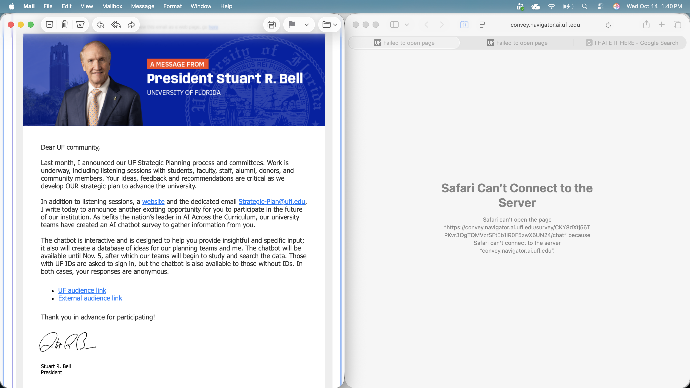

```{r}
#| label: setup
#| include: false
knitr::opts_chunk$set(echo = FALSE, message = FALSE, warning = FALSE)
source("figure-packages/week-summary/R/week-summary.R")
```

# Analysis and Modeling {#sec-analysis}

::: {.callout-note icon="false" title="This content was identified, synthesized, and written by humans."}
📊 But the analyses don't have to be. Even beginners can watch Google's AI agent take a dataset from raw to modeled in under seven minutes ([video](https://www.youtube.com/watch?v=_Md_XD67oTY)), then try it themselves with free Gemini access in Colab ([notebook](https://colab.research.google.com/github/googlecolab/colabtools/blob/main/notebooks/Getting_started_with_google_colab_ai.ipynb)).
:::

On October 6, 2026, OpenAI posted 722 math papers on GitHub, claiming that an unreleased AI model has produced solutions or substantial progress on hundreds of open problems[@openai2026math; @openai2026repo; @hart2026breakthroughs]. For some mathematicians, this was seen as "possibly the single most important day in the history of mathematics"[@proofsandprompts2026reactions]. For others, it was "the sunset of mathematics"[@proofsandprompts2026reactions]. In the aftermath, six probability and statistics journals paused new paper submissions altogether[@edp2026esaim]. Humans endorsed some results (e.g., the quasi-Riemann proof)[@kakaes2026quasi], and OpenAI was forced to withdraw others[@openai2026history; @retractionwatch2026withdraws]. And at the same time that the Association for Human Mathematics urged mathematicians to stop working with OpenAI[@ahm2026statement], other frontier AI labs pressed ahead in the race of AI-driven mathematics[@tsoukalas2026advancing; @anthropic2026riemann]. While this race intensified, we continued one of our own: a race to understand how our lives as researchers may soon change (@fig-week-08-summary).

```{r}
#| label: fig-week-08-summary
#| fig-cap: "Overview of Week 8 of the Fall 2026 Collective [Artificial] Intelligence Seminar. Left: top discussion points, along with estimated level of agreement among seminar participants. Right: three most popular resources identified by seminar participants."
#| fig-width: 12
#| fig-height: 5.5
#| fig-align: center
week_summary_plot(week = 8, fig_width = 12, fig_height = 5.5)
```

Week 8 of the Collective \[Artificial\] Intelligence in Science seminar focused on both the benefits and perils of using AI for data analysis. This was initially planned to be a two-week process, but was condensed into one week due to a concern: that we were running out of time to discuss the sooner-than-expected existential threats that AI poses to science.

For example, two seminar participants provided a demo of AI-assisted data analysis in Google Colab[@fine2025colabagent], providing a low-skill entry point for students who need help planning, drafting, and editing analysis notebooks. Two other seminar participants presented a blog post illustrating how AI models can be used both to (a) intentionally create misleading claims, as well as (b) better ensure one's claims don't mislead[@stone2026phack]. Differences in researchers' goals matter — as do the models they deploy. E.g., some models were shown to be useful for specifying formal models, whereas others struggled to produce anything usable[@sfeir2026choice]. Corporate recruiters are increasingly emphasizing the importance of not only knowing that AI *can* be used for data analysis — but also how and why it fails[@walker2026gmac]. The importance of such insights became particularly relevant as we watched our own university president launch two AI-based data collection tools — both of which immediately crashed (@fig-week-08-survey-crash).

{#fig-week-08-survey-crash fig-align="center" width="90%"}

## Areas of consensus — and dissensus

Like past weeks of the seminar, we used Delphi surveying to identify key areas of agreement and disagreement[@Coles2024; @dalkey1963delphi]. For example, there was clear consensus that AI deepens pre-existing concerns about the use of questionable research practices in science[@john2012qrp]. Similarly, there was near consensus that such models cannot yet support real-world clinical decision making. However, there was less agreement about how researchers should handle ambiguity in data analysis pipelines, with most students agreeing that it may not be feasible or desirable to report all considered analyses.

Perhaps the most challenging issue we debated was about who gets to do the science. AI appears to both democratize and concentrate power in science. For example, in April 2026, a 23-year-old with no advanced math training used ChatGPT to solve a 60-year-old Erdős problem[@howlett2026amateur]. Yet, when OpenAI released 722 mathematics papers 6 months later, some mathematicians described it as "a tsunami that we have no time to prepare for", reporting feelings of paralysis, disorientation, bewilderment, and grief (@fig-week-08-math-reactions)[@proofsandprompts2026reactions]. Such developments served as the backdrop for a topic we never intended to focus on in Week 8: Who gets to do the science in the age of AI? (see @sec-ethics-who)

![Phrases from more than 100 mathematicians' reactions to OpenAI's October 6, 2026 release of AI-generated mathematics papers[@proofsandprompts2026reactions].](images/week-08-math-reactions.png){#fig-week-08-math-reactions fig-align="center" width="100%"}