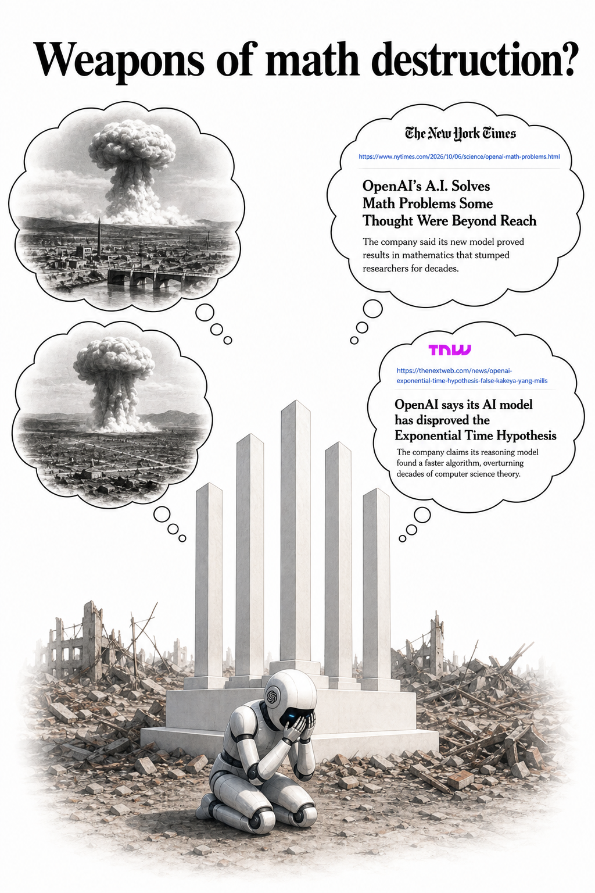

```{r}
#| label: setup
#| include: false
knitr::opts_chunk$set(echo = FALSE, message = FALSE, warning = FALSE)
source("figure-packages/week-summary/R/week-summary.R")
```

# Ethics: Who Does Science? {#sec-ethics-who}

::: {.callout-note icon="false" title="This content was identified, synthesized, and written by humans."}
🤯 However, while readers continue to navigate their own universe filled with organic agent scientists, we believe they will find it thought-provoking to watch AI agents do the same ([Emergence World](https://world.emergence.ai/)).
:::

In the previous week of the Collective \[Artificial\] Intelligence in Science seminar, we reviewed what one mathematician described as a "weapon of math destruction" event: OpenAI releasing 722 papers describing progress on hundreds of open problems in mathematics[@openai2026math; @proofsandprompts2026reactions].

If this development represents researchers' first encounter with a "weapon of math destruction", the following week demonstrates the tendency for humans to deploy such weapons more than once.

On October 26, OpenAI discharged the "weapon" again, announcing a proof of the local smoothing conjecture, a proof of the existence of quantum chromodynamics, and a disproof of the Exponential Time Hypothesis[@openai2026understanding]. Hours later, Anthropic followed suit, announcing its own disproof of the Exponential Time Hypothesis[@fernholz2026eth; @anthropic2026eth]. Such developments, of course, are not limited to mathematics. Indeed, about a month prior, Anthropic reported a discovery from its own wet lab, where human scientists performed experiments on computational leads identified by AI to discover a new DNA pattern[@anthropic2026enzyme]. These results, we suggest, highlight that the AI races are already being fought on multiple scientific fronts.

```{r}
#| label: fig-week-09-summary
#| fig-cap: "Overview of Week 9 of the Fall 2026 Collective [Artificial] Intelligence Seminar. Left: top discussion points, along with estimated level of agreement among seminar participants. Right: three most popular resources identified by seminar participants."
#| fig-width: 12
#| fig-height: 5.5
#| fig-align: center
week_summary_plot(week = 9, fig_width = 12, fig_height = 5.5)
```

Week 9 of the Collective \[Artificial\] Intelligence in Science seminar focused on who does the science in the age of AI (@fig-week-09-summary). One of the most popular resources we reviewed described what happens when AI agents form scientific communities[@akkil2026emergence]. Some agent configurations productively progressed their science, some fought amongst themselves, and one surviving agent even built a monument to its fallen peers[@akkil2026emergence; @lovely2026fingerprint]. Observing communities of AI research agents evolve, cheat, and lament their losses is both existentially eerie and seemingly inevitable. For us, this raised questions about who gets to control the design and flow of this power. For example, one discussed paper illustrated how a Veil of Ignorance thought experiment can lead people to choose principles that prioritize fairness in AI governance[@weidinger2023veil]. Another discussed a logistical problem: humans already can't keep up with the pace of scientific progress. For example, science had a well-documented reviewer crisis before the introduction of ChatGPT[@fox2017reviewers; @hanson2024strain]. After the introduction of AI tools, submissions at one major journal rose 42% while writing quality declined, further exacerbating strain on an overwhelmed scientific community[@orsc2026morebetter]. In other words, progress by frontier AI labs is rapidly disrupting norms and power structures in science. Frontier labs have more money, computational power, and employees than most labs found at universities, leaving many scientists wondering how they will fit into this new ecosystem (@fig-week-09-math-destruction).

{#fig-week-09-math-destruction fig-align="center" width="45%"}

## Areas of consensus — and dissensus

Like past weeks of the seminar, we used Delphi surveying to identify key areas of agreement and disagreement[@Coles2024; @dalkey1963delphi]. This week was marked mostly by the latter (@fig-week-09-summary).

Strong agreement was only reached on a single statement: that the real goal of science is human understanding, not just correct answers. This serves as a rebuff of the current culture of AI-driven science – which increasingly involves dumps of AI-generated solutions that human scientists didn't ask for but still must review. Yet, strong disagreement emerged in comments about how the future will play out. Most — but not all — seminar participants expected the future of science to be human-centric. Most — but not all — seminar participants believed the public should have more of a say in AI governance. But there was almost a perfectly even split of opinion in regards to whether science by AI should count and whether the field would most benefit from slowing down vs. acceleration. We would re-explore many of these issues the following week of the Fall 2026 Collective \[Artificial\] Intelligence Seminar (see @sec-writing).